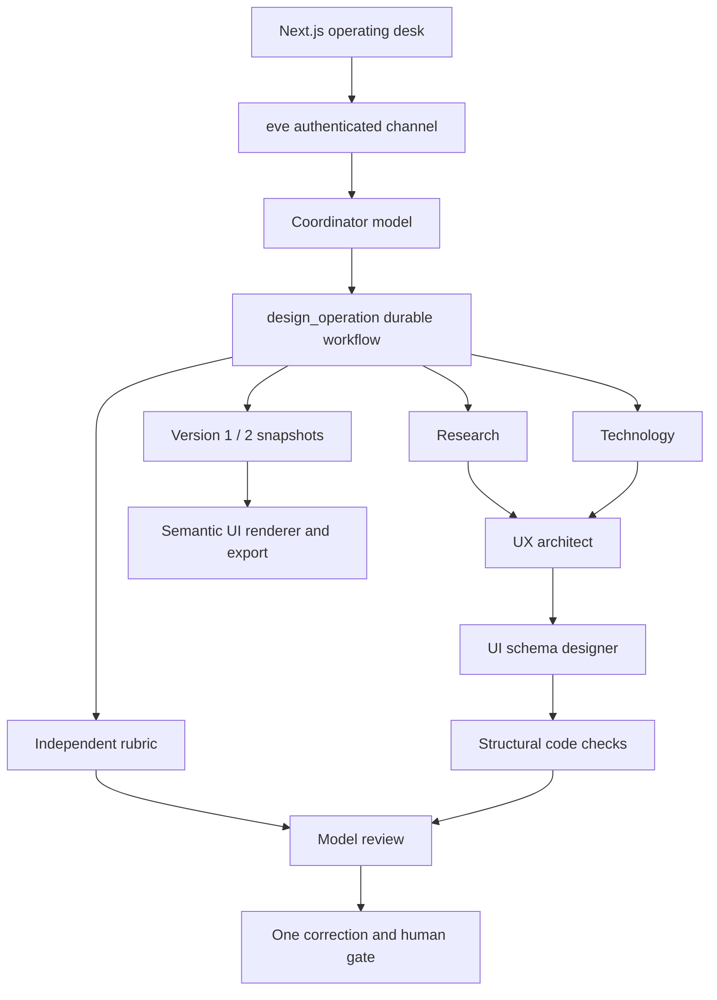

# PRODUCT / ZERO / V1 Phase 0 audit

**AI Product Design Operating System**  
Audit date: 2026-10-29. Status: **audit complete; V1 acceptance not met**.

## Decision

Preserve the existing Next.js/eve application and accepted visual system. The current product performs genuine model-powered, durable document/artifact orchestration, but it cannot yet build the real applications named in the mission. Its largest gap is the execution contract, followed by project persistence, functional evaluation and scoped revision. Renaming stages or improving prompts cannot remove these limits.

No product code, production deployment, user operation, approval or account billing configuration was changed during this audit. A Git checkpoint was created before audit artifacts were written. No AI inference was purchased or requested for this audit.

## Baseline and evidence

- Repository: `Hoohaahaa/Portfolio`, branch `product-zero-os`, head `cab5c310a8ca361058801b61ce64887dab9ae55d`.
- Checkpoint: `checkpoint/product-zero-pre-v1-2026-10-29`, confirmed at that same commit.
- Existing production: `product-zero-os`, deployment `dpl_AWy3V3MqmRC5JhvbiBXkc4781AQQ`, platform state READY. READY means the deployment built, not that generated applications meet their requirements.
- Source recovered from the previously preserved review archive after workspace maintenance. Its content manifest matched. The live Git branch head matches the archive's recorded source commit. Application code in this package is the frozen baseline, not a rewritten application.
- The actual music HTML export was recovered separately. Its SHA-256 is `07de74763a5c84a8c54b9f9a0bd13dee31b7f7c33e9a6daeeb8d74e57680e4d9`. Embedded JSON was parsed without executing the script. This evidence was missing from the earlier review ZIP and is present here.
- Existing Studio session evidence is separately labeled. It must not be mistaken for the user's music run.
- Current deployed navigation and model configuration were inspected in a browser. Owner authentication was not established, so private session UI and current account balance were not reverified. No inference button was pressed.

## Actual architecture

The five specialist roles are real model contexts. Research, technology and rubric generation run concurrently. UX, schema design, code checks and model review follow. eve/Vercel Workflow persists execution; the browser's `pz-runs` index provides recent-run navigation. There is no canonical project database, source registry, application builder, test runner, dependency impact planner or merge/rollback engine.

## Capability inventory

The full inventory with code/evidence references is `CAPABILITY-INVENTORY.csv`. Status terms are deliberately narrower than marketing claims.

| Status | Actual capability |
| --- | --- |
| Implemented and tested | Brief/schema checks, real historical inference and specialist execution, snapshot export, existing UI navigation, baseline build/typecheck; semantic renderer fixture behavior has earlier evidence |
| Implemented but failing | Music output against its camera/audio requirements; designer correction schema failure; reviewer candidate-grounding in the Studio example; inconsistent execution/approval projection |
| Partially implemented | Shared context, reference IDs, revision numbers, durable session persistence, provenance, model budgeting, review gates, design-system adapters |
| UI-only for the claimed behavior | Generated camera/pitch/audio-status controls; technology recommendations are not running integrations; a save message is not durable project storage |
| Planned but absent | Persistent project/version registry, source generation/build isolation, functional test orchestration, scoped changes and locks, comparison/accept/revert, provider adapters, project-wide cost reservations, voice intake |

## Findings and root causes

### P0 / F01: The output contract cannot represent the requested application

`lib/contracts.ts` restricts blocks to text, input, select, button, list, metric and toggle. Actions are none, navigate or submit. `app/_components/prototype.tsx` and `lib/export.ts` interpret those blocks. They do not create camera streams, hand-tracking inference, audio nodes, keyboard-to-note mappings or an executable source project. The designer is explicitly instructed not to emit raw HTML or JavaScript.

The actual music export contains four screens and seven requirements, but its executable tail has no `getUserMedia`, `AudioContext` or oscillator implementation. This is a representation boundary, not a missing polish pass. Keep this exporter, relabeled as a low-fidelity artifact type; add a separate source/build product type.

### P0 / F02: Green checks do not establish working behavior

`validateArtifacts()` checks reference existence, identifier uniqueness within each screen, HTTPS URL shape and one token contrast ratio. It does not execute acceptance criteria. The actual failed/rejected music snapshot is UI-schema-valid and passes all eight checks. The actual Studio candidate also passes them despite having no submit action.

Eight new audit characterization tests reproduce these weaknesses. Their passing results confirm gaps; they are not V1 success tests.

### P0 / F03: There is no scoped iteration or durable product head

`Snapshot.version` is a number set to 1 and optionally 2 inside one workflow. New operation starts a new session. There is no project identity, accepted-head pointer, change set, file manifest, dependency lock, branch, code diff, acceptance transaction or rollback operation. Exported `versions` are deduplicated by revision integer alone; separate workflow attempts can reuse those numbers and collapse distinct attempts in that view. The underlying archived events retain more history than the version summary.

### P0 / F04: Budgeting is not a no-spend execution policy

The root has dollar/token session thresholds; specialists have dollar-only thresholds. Free-model tokens can therefore accumulate without a child token ceiling. Installed eve documentation states descendant usage aggregates to the parent, but children of an execute workflow tool count when the tool finishes. That is not an atomic, advance reservation across all calls. There is no persistent per-project ledger, zero-price allowlist enforcement in the application, tool/infrastructure allowance or privacy-consent gate. Optional research tools are installed unconditionally; the no-search rule is a prompt instruction, not a technical permission boundary. Do not enable paid search or paid model fallback during V1 work.

### P1 / F05: Requirements, technology and rubric can disagree

The recovered music artifact sets latency at 150 ms in R04, 100 ms in technology decisions and 50 ms in the rubric. All checks still pass. The three early specialists receive the brief concurrently, without a canonical acceptance contract or subsequent reconciliation. A proposed bound must become a versioned decision before it is evaluated. None of these values is a measured result.

### P1 / F06: Review is a critique document, not authoritative verification

Review findings store a free-text artifact name and proposed fix, without mandatory requirement/component/test IDs or candidate digest. In the archived Studio example, the actual two-screen candidate receives a finding about four distinct screens. The music evaluator discusses specifications and presentation, not a running instrument. A separate model context is useful but does not establish reliable independence, factual correctness or executable validation.

### P1 / F07: Execution, approval and readiness are conflated

In `app/workspace.tsx`, every open interaction is rendered under the same design-review heading. A compute-budget continuation can therefore appear as artifact approval. The state ternary does not explicitly handle failed, cancelled, blocked or completed-with-warnings snapshots. The human-decision summary maps every non-approved snapshot to Pending, including a rejected snapshot. Error guidance sends schema/runtime errors toward model access. Artifact count means objects exist, not that they work. Preserve the visual system and replace this projection with typed state selectors and evidence links.

### P1 / F08: Persistence is execution history, not a product registry

eve sessions and exported snapshots are real. The project index is browser-local and capped to the latest 30 records. No shared cross-device project registry is connected. The generated prototype's field values are in memory; the HTML export does not implement the localStorage persistence described in some generated notes. Do not use Vercel ephemeral disk as the missing durable database.

### P1 / F09: The renderer has a narrower interaction contract than its data

The music select block declares a navigate action, while select changes only store a value. Submit buttons such as Mute Audio or Start Calibration produce a generic local saved message; they do not perform those named actions or follow submit targets. Field values use block IDs globally, while uniqueness is checked only within a screen. Cross-screen duplicate IDs can therefore share state. These are additional reasons to separate executable application code from semantic UI artifacts.

### P1 / F10: Correction failure details are not diagnosable enough

The actual music export is v2, phase failed, approval rejected and review verdict revise. Its summary names a designer output-schema failure. It retains earlier artifacts. The invalid correction payload, exact schema issue path, attempt timings and full music session stream are not available in that file; the exact offending field cannot be determined. Do not infer a person's approval action from the serialized rejected value alone.

The archived Studio stream also records an unwanted whole-workflow restart after failure. Later source adds a human pause in the catch path and a root token threshold. Those changes compile; deliberate live failure injection and an operation-level once-only guard remain unverified. A prompt saying run once is not an idempotency mechanism.

### P2 / F11: Evidence confidence exceeds verification infrastructure

The music artifact contains source-backed claims, numerical latency/FPS claims and retrieval-looking URLs, but it does not include source snapshots or the search transcripts needed to verify them. The code's source check only recognizes HTTPS. The full research and technology claims remain unverified. No new interviews, participant results, hardware measurements or citation verification were performed for this audit.

## Tests and inspection actually performed

| Check | Result | Boundary |
| --- | --- | --- |
| Existing Node contract suite | 10/10 passed | Structural contracts only |
| New characterization probes | 8/8 passed | Confirms current gaps, not acceptance |
| TypeScript check | Passed | No runtime quality proof |
| Next production build | Passed | Four upstream Carbon CSS `@position-try` warnings |
| eve agent compilation | Passed | Does not run model inference |
| Live deployed navigation | Overview, Operation, Artifacts, Review, System inspected | Unauthenticated shell; private sessions not retested |
| Responsive overview measurements | No horizontal overflow in seven requested frame sizes | Harness inner widths are 2 px smaller due to border-box; exact recorded dimensions are in JSON |
| Actual music export | Embedded state and executable tail inspected statically | Local-file browser execution blocked by browser protocol policy; no workaround used |

No physical camera, hand-tracking accuracy, speaker output, audio latency, end-user usability or new overnight execution test was performed. Historical evidence is labeled with its original date. Screenshots captured during execution are not treated as final-state proof.

## V1 direction and sequence

`V1-ARCHITECTURE.md` specifies the proposed persistent model, bounded agents, source/build contracts, execution/readiness separation and integration boundaries. `IMPLEMENTATION-PLAN.md` defines the first complete loop and regression strategy. These are proposals, not implemented V1 functionality.

First prove one bounded real application and one component revision: create → actual preview → select → plan with locks → approve compute → patch → build → functional tests → compare → accept → reopen → revert. Start with a keyboard-playable Web Audio instrument. Camera tracking remains explicitly unsupported until implemented and tested on a real device; this first slice is not the complete camera-instrument project.

Do not add the travel content pipeline, Figma sync or all lifecycle agents before that loop passes. Do not promise completion in a fixed number of iterations.

## Preservation and cost outcome of Phase 0

The production branch and deployed application remain unchanged. The checkpoint and audit branch preserve reviewable evidence. Accepted CSS, typography, fonts, navigation and responsive layout are hashed for regression comparison. No billing setting, integration permission, model configuration, customer operation or approval was changed. Current free connectivity was preserved; this audit did not make a new inference request or certify future free-model availability.
