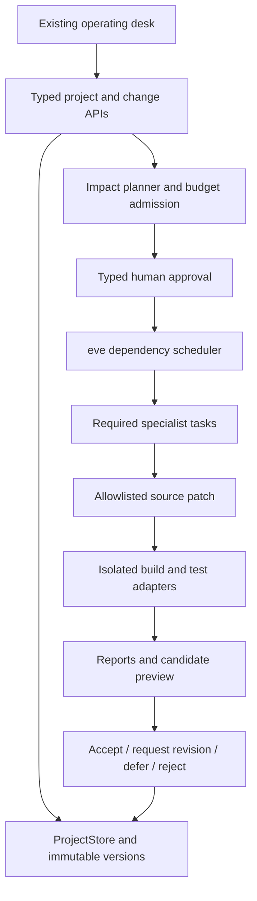

# PRODUCT / ZERO / proposed V1 architecture

Status: **PROPOSED**, not shipped. Keep the existing UI shell, eve runtime and semantic exporter. Add product persistence, executable build artifacts and a scoped change engine behind them.

## Control plane and execution plane

The LLM proposes artifacts and patches. Deterministic services own IDs, locks, authorization, pricing admission, state transitions, test results and accepted version pointers. Never ask a model to decide whether its own code passed a test.

## Canonical product model

Use a schema-versioned graph of typed records, not a larger prompt string. IDs are opaque, stable and namespaced by workspace/project. Edits keep entity IDs and advance immutable revisions. All references must resolve in the candidate graph; archived references retain version IDs.

| Entity | Required relationships / data |
| --- | --- |
| Workspace / Project | Owner, privacy policy, project type, current accepted version, model/tool budgets, legacy session mappings |
| IntentRevision | Original brief, evolving goal, constraints, non-goals, audience, approved scope, predecessor |
| Evidence | Source URL/file hash, retrieval run/time, quoted span or source artifact, license/consent, confidence, assumption flag; no fake retrieved state |
| Requirement / AcceptanceCriterion | Stable ID, rationale, decision references, typed assertion or explicit human/hardware verification method, affected capabilities |
| Decision | Alternatives, trade-offs, chosen approach, rationale, actor, approval state, superseded-by reference |
| Journey / Flow / Transition | Node/edge IDs, requirement refs, entry/exit conditions, error and recovery states |
| Page / Component / Interaction | Source file and export-symbol refs, states, input/output events, accessibility contract, requirement coverage |
| TechnicalArchitecture / Dependency | Runtime capabilities, package locks, device/permission requirements, module edges and design-token edges |
| SourceFile / Artifact | Content digest, immutable blob/commit reference, type (wireframe/application/spec/report), producing task, base version, readiness |
| Test / Evaluation / Finding | Executed command/assertion, runner/version, candidate digest, result, evidence artifact, exact entity refs, evaluator provenance |
| ProductVersion / Branch | Immutable manifest, parent IDs, branch ID, accepted-head reference, validation summary, rollback target |
| ChangeSet | Base version, selected scope, requested behavior, allowed paths/entities, locked hashes, impact graph, plan, risks, budget reservation, candidate IDs |
| Execution / AgentTask / Attempt | Scheduler state, dependency IDs, prompt/contract version, actual model/provider, error class, attempt number, checkpoint, usage and cost |
| Approval / CostRecord | Kind, actor, request payload digest, decision/time, authorized amount/scope or candidate digest; separate model/tool/runner charges |

Acceptance criteria must be canonical. For example, a latency bound is one approved record used by requirements, technology selection and evaluation. Proposed alternatives may suggest another bound but cannot silently redefine it. Unknown hardware measurements remain `not-run`.

## Persistence decision for the owner pilot

Use a `ProjectStore` interface. For the first owner pilot, prefer a private Git-backed immutable file/artifact store and an expected-head transaction for accepted project state, with browser IndexedDB only as a cache. Each accepted version resolves to real source and model manifests. This uses the existing GitHub resource rather than assuming an unprovisioned paid database.

This is **not currently connected inside the app**. The Work GitHub connector being able to create a checkpoint does not grant the deployed application credentials. A narrowly scoped GitHub App/connection and backend adapter must be authorized and verified before this store is claimed working. The control plane must restrict writes to the approved project namespace and never touch the existing production/proposal branches. Use a new private project repository when available; otherwise an explicitly approved branch prefix in the existing private repository is the pilot fallback.

Git-backed acceptance should use `createCommitOnBranch` with `expectedHeadOid`, or equivalent verified compare-and-swap semantics. A stale head returns a conflict; never force-push or overwrite another accepted change. Candidate code and metadata are immutable; accepting advances a pointer, rejecting preserves history, reverting creates a new version referring to prior content. Batch event chunks at checkpoints instead of committing each token. A transactional database adapter can replace this low-volume pilot store later without changing domain contracts.

Do not use serverless temporary disk as persistence. If the required storage connection is unavailable, mark the persistence step blocked rather than substituting browser-only state and claiming cross-device durability.

## Legacy migration without data loss

1. Keep `?session=` routes and the old renderer as read-only legacy views.
2. Import known browser run indices and user-supplied exports; unknown sessions must not be invented or silently omitted.
3. Identify snapshots by legacy session + workflow call ID + sequence + revision number, not revision number alone.
4. Preserve original snapshots, source labels, failures, approvals as recorded and content hashes. Missing actor/source/code fields stay unknown.
5. Give the imported operation a Project/LegacyArtifact record without pretending that it contains executable source files.
6. Validate import/export round trips and compare all original artifact hashes before enabling editing. Rollback the migration pointer if checks fail; never delete legacy evidence.

## State and approval contracts

Execution states: queued, planning, running, blocked, awaiting-input, awaiting-review, failed, cancelled, completed-with-warnings, completed. A state selector uses typed run events and task aggregation, not the existence of artifact objects.

Keep orthogonal dimensions:

- Artifact: not-produced / partial / built / testable / invalid.
- Validation: not-run / running / passed / failed / requires-device-validation.
- Human approval: not-requested / pending / accepted / deferred / rejected.
- Release: not-requested / blocked / eligible / released.

Approval kinds: `compute-continuation`, `change-plan`, `artifact-acceptance`, `data-sharing`, `external-write`, `release`. Each targets a payload digest and relevant version. A budget Continue button cannot accept an artifact. Production release is outside the first vertical slice.

## Scoped revision transaction

Select entity/flow → describe behavior → compute transitive impact → display required paths and tests → lock all unaffected hashes → approve plan and compute → create candidate → apply patch → build → test → compare → accept or keep/reject candidate.

Scopes include element, component group, page, flow, design system, data model, technology, architecture and whole product. Implement component scope first. Unsupported wider scopes are explicitly disabled, not decorative options. Any touched locked path, stale base hash or undeclared dependency expansion rejects execution and requires an amended plan. Do not widen scope on model advice alone.

Patch output: changeSet ID, base version/digest, declared file operations, stable entity refs, rationale and proposed tests. The engineering role cannot rewrite acceptance tests or lock policy. Added tests are reviewable; existing regression tests cannot be weakened to pass a candidate.

## Real application build contract

Retain `semantic-ui` as a low-fidelity output. Introduce `application-source` with a source manifest, fixed dependency lock, entrypoint, runtime capability manifest, build report, executable preview bundle and test report. `unsupported` is a first-class capability outcome.

For the smallest slice, use a trusted browser/Web Audio starter and allowlisted TypeScript modules. A server build step may parse/transpile/bundle code with a fixed trusted build configuration; it must not execute generated code, install model-selected dependencies or expose secrets. The functional UI runs in an isolated preview, not in the operating desk's JavaScript context. Use a deny-by-default CSP and no owner cookies/credentials in previews. Pure generated logic tests can run in a time-limited worker; browser behavior must be tested in an actual permitted browser environment.

Do not combine script execution and same-origin privileges with the owner application origin. Hardware-capable previews need a separate secure origin, narrow Permissions Policy, explicit user gestures and no owner authentication cookies. Camera features remain blocked until that path and actual device behavior are verified. An opaque-origin iframe suitable for a no-camera prototype is not a substitute for a working camera preview.

Use a `BuildRunner`/`BrowserTestRunner` adapter. A verified no-cost runner is a prerequisite to unattended browser tests. Existing Work checks are engineering evidence, not a production runner integration. GitHub Actions is an optional adapter only after its actual private-repo allowance and hard stop controls are checked; do not enable billable runners or overage. If no runner is connected, use a truthful blocked/awaiting-browser-validation state. Never generate a PASS report in model text.

## Agent catalog and scheduling

| Role | Input → output | Measurable evaluation |
| --- | --- | --- |
| Research | Approved material → evidence/unknowns/research plan | Source provenance resolves; unsupported findings stay hypotheses |
| Product strategy | Intent + evidence → scope, requirements, acceptance IDs | Conflicts reconciled; each requirement testable or explicitly human/device-gated |
| Systems architecture | Requirements + capabilities → architecture/dependencies | Runtime compatibility, permissions and unsupported capabilities checked |
| Interaction design | Canonical requirements → flow/state contracts | Reachability, recovery paths and executable event mapping |
| Visual design | Existing tokens/components → constrained layout/style patches | Token/lock compliance and screenshot comparison; no uncontrolled redesign |
| Engineering | Approved plan + source base → allowlisted source patch | Build succeeds; invariants and behavior tests pass |
| Testing | Candidate digest + locked acceptance tests → runner reports | Actual commands and browser assertions, not model assertions |
| Independent evaluation | Exact candidate + actual reports → linked findings | Every finding resolves to candidate/entity/test; stale findings rejected |

Use only needed roles per task. A component correction should not rerun research. Test-plan authoring may run alongside engineering; execution waits for the built candidate. An evaluator may critique only the candidate digest actually supplied.

## Model, retry and budget adapters

Keep current free connectivity; introduce `ModelAdapter` with capability, privacy, pricing and usage metadata. Business logic must not contain provider-specific model strings. Cloud/Gateway, future direct BYOK and local adapters are separate configurations; none is claimed implemented by a shared interface alone.

Before each run, classify data and check permission to send it to the actual provider. Unknown/confidential input is blocked for retention/training-enabled trial endpoints unless specifically authorized. Public search is off unless its permission and cost are approved in code.

Reserve tokens/cost for the operation and project before dispatching each task, including children, retries, tools and runner work. Reconcile actual reports after each attempt. Zero monetary cost still needs token, call, concurrency and wall-clock bounds. The first trial policy must reject nonzero-priced models/tools and paid fallback. Catalog availability is not a future billing guarantee; account-side hard-stop controls and current rates must be verified.

Proposed first-slice defaults: 12 model calls maximum, 2 concurrent, 120k total input and 24k total output tokens, at most one schema repair per task, three builds/test runs and $0 authorized model/tool/infrastructure spend. These are proposed caps, not an estimate or settings already changed on the user's account. Plan estimates must disclose unknowns and never invent usage or savings.

Error classes: authentication, permission, insufficient budget, quota/rate limit, provider timeout, invalid structured output, patch conflict, build failure, functional failure, unavailable capability and cancelled. Retry only classified transient errors with bounded backoff; one schema repair receives precise issues. Never retry the whole DAG. Checkpoint successful task outputs with their input digests. A resumed task must use an idempotency key and cannot publish a second accepted version.

## Integration boundaries and open prerequisites

Current GitHub/Figma/team adapters are absent in the application. Future adapters expose read/write capabilities, permission scopes, idempotency, actual transaction receipts, data retention and cost. Read-only audits and code generation do not imply Figma synchronization or an external team update occurred.

Before the first slice: verify Git-backed persistence authorization, available no-cost build/browser runner, model eligibility/privacy policy, accepted scope and test device/browser. No paid provisioning, identity migration or customer-data import is authorized by this architecture document alone.

## Primary references checked for the proposal

- Installed eve 0.85.0 docs: agent-config, concepts/state, workflow tools and client streaming. Session memory is not an independent product registry; child usage aggregates on the framework's documented schedule.
- GitHub commit transaction: https://docs.github.com/en/graphql/reference/commits (`expectedHeadOid`).
- GitHub Actions allowances/budget behavior: https://docs.github.com/en/billing/concepts/product-billing/github-actions and https://docs.github.com/en/billing/reference/product-usage-included . Account allowance has not been verified; no paid usage enabled.
- Vercel function restrictions: https://vercel.com/docs/functions/limitations . Do not rely on an indefinitely running HTTP request or persistent temporary disk.
- Preview security: https://developer.mozilla.org/en-US/docs/Web/HTML/Reference/Elements/iframe and https://developer.mozilla.org/en-US/docs/Web/API/MediaDevices/getUserMedia . Hardware access must be validated separately from sandboxed document rendering.
