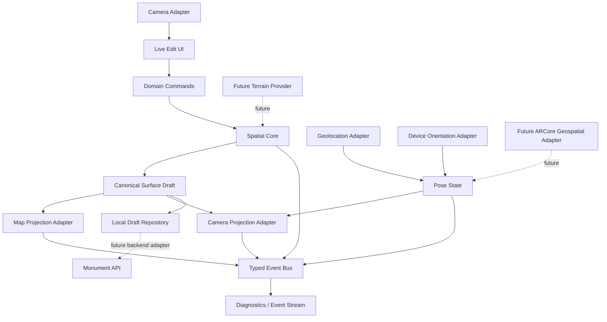
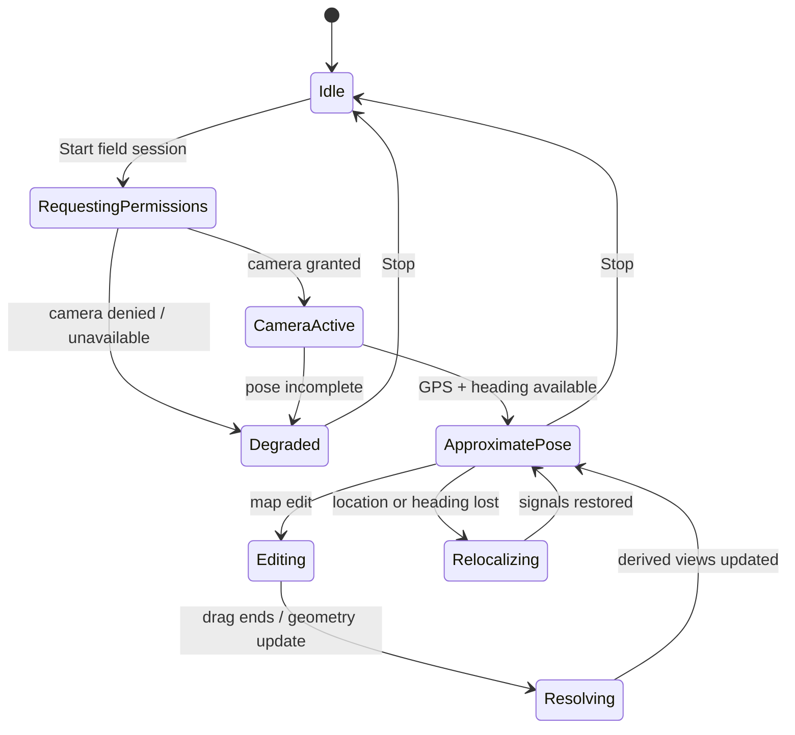

# Spatial Engine System Map

Status: prototype architecture map.

## Runtime state flow

## Coordinate pipeline
Map pointer (EPSG:3857) → Leaflet LatLng → WGS84 anchor → geodesic endpoints → map footprint.
Device GPS + heading → approximate pose → observer-to-anchor bearing → FOV projection → camera overlay.
The two projections share the same domain draft; neither projection is the source of truth.
