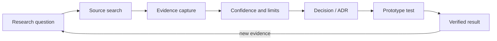

# Monument Spatial Research Register

Status: open research backlog. Last updated: 2026-11-18.

This register is the source of truth for unresolved technical research. An unanswered question must remain open; do not turn a plausible assumption into a product fact.

## Research workflow

Every research item should record:
- ID and question;
- why the answer changes a product/engineering decision;
- authoritative sources and retrieval date;
- evidence excerpt or summary;
- confidence and known limitations;
- prototype test that can falsify the hypothesis;
- decision/ADR affected;
- owner and next review date.

## Open research items

| ID | Question | Priority | Status | Decision affected | First discriminating test |
|---|---|---:|---|---|---|
| RQ-001 | Does the exact Galaxy A32 variant expose stable absolute device orientation in the target Android browser? | Critical | Open | Browser sensor adapter vs native Android | Compare orientation events with known cardinal bearings and runtime metadata. |
| RQ-002 | What is the compass heading error and jitter across open sky, near metal and different phone orientations? | Critical | Open | Heading filtering and confidence UI | Stationary 60-second samples at known bearings; record circular variance. |
| RQ-003 | What horizontal and vertical position accuracy does the target device achieve at the user's actual field-test sites? | Critical | Open | Approximate map placement fallback | Repeat high-accuracy location fixes and compare with a known reference. |
| RQ-004 | Does the exact device/runtime pass ARCore Geospatial mode support checks? | Critical | Open | Native AR stack selection | Run the official runtime support check on device. |
| RQ-005 | Is VPS available at the test location and what localization quality is reported? | Critical | Open | VPS-backed world anchoring vs GPS approximate | Query VPS availability at the field site and run a small geospatial anchor test. |
| RQ-006 | Which terrain/elevation provider has adequate coverage, resolution, vertical datum, license and cost? | High | Open | TerrainProvider adapter | Compare the same ridge/valley samples across candidate datasets and a trusted reference. |
| RQ-007 | What are the map tile licensing, attribution, rate-limit and offline requirements for the production map? | High | Open | MapAdapter/provider selection | Review provider terms and test target-area caching/offline behavior. |
| RQ-008 | What is the actual camera horizontal/vertical FOV and distortion on the target handset? | High | Open | Camera projection calibration | Compare camera calibration metadata or measured field-of-view against nominal projection. |
| RQ-009 | Can the target phone render a small mesh with stable frame time, memory and thermal behavior? | High | Open | Unity/native rendering selection | Build a minimal native vertical mesh and profile sustained use. |
| RQ-010 | What sampling interval is required for a visually stable terrain-following lower edge? | High | Open | Terrain mesh resolution and tile size | Compare mesh output across terrain sample spacings on ridge/valley fixtures. |

## Evidence status vocabulary

- **Open:** no adequate evidence yet.
- **Researching:** authoritative sources are being compared.
- **Prototyped:** a local proof exists but has not passed field validation.
- **Verified:** repeatable evidence supports the claim within stated limits.
- **Rejected:** evidence falsified the hypothesis; preserve the reason and test.

## Initial constraints

- The browser Spatial Lab is a UX/geometry/sensor prototype, not a replacement for ARCore Geospatial.
- The existing private Neon preview bucket does not mean asset upload or cloud persistence is implemented.
- The selected v1 geometry remains a vertical curtain with a terrain-following lower edge.
- Keep authoring hierarchy Location → Space → Content when the content-authoring flow is connected.
- Keep diagnostics secondary/collapsible; do not cover the camera scene with raw technical data.
- Preserve the Monument orange visual direction (#FF573D); the rejected green UI theme must not return.
